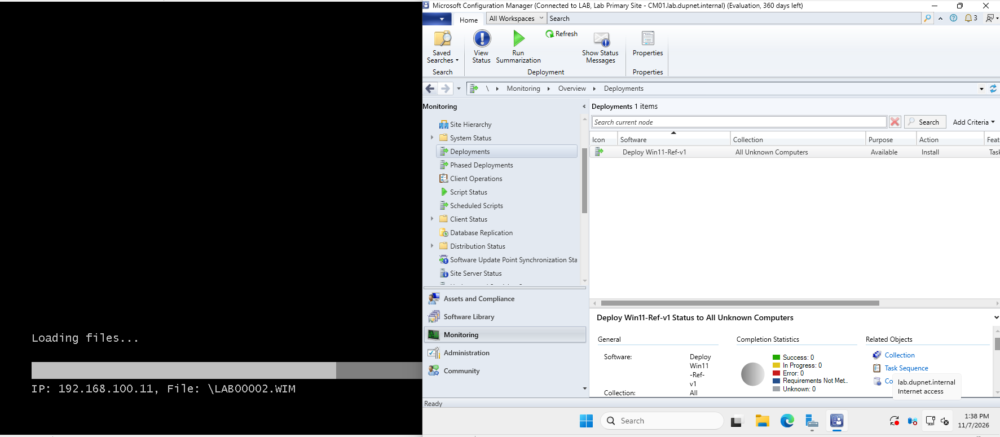
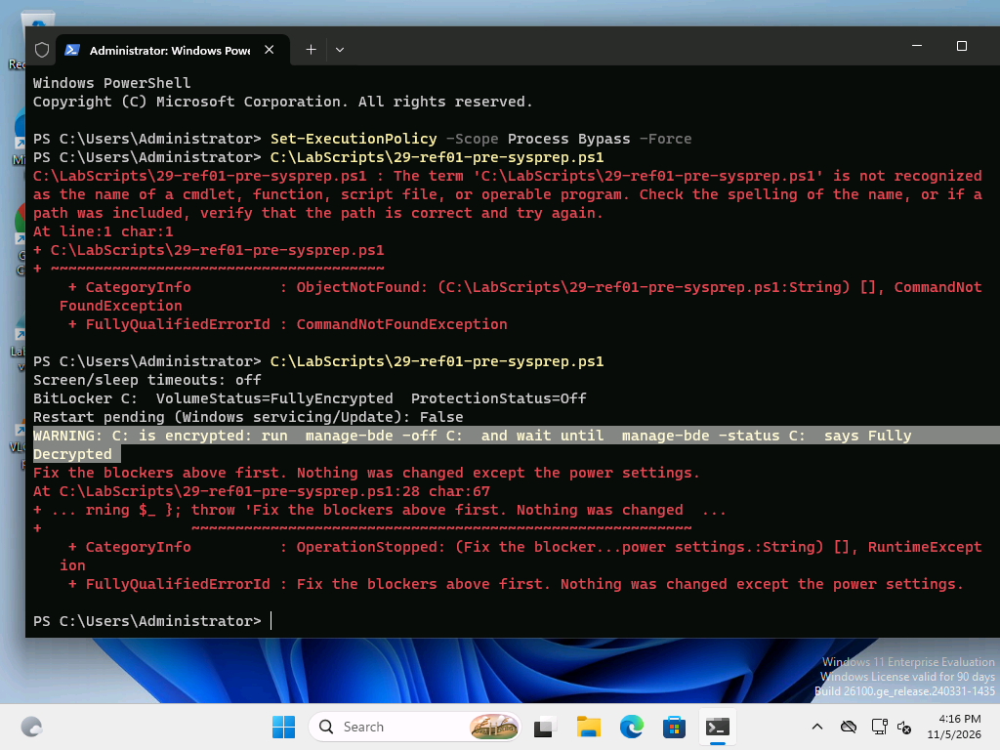
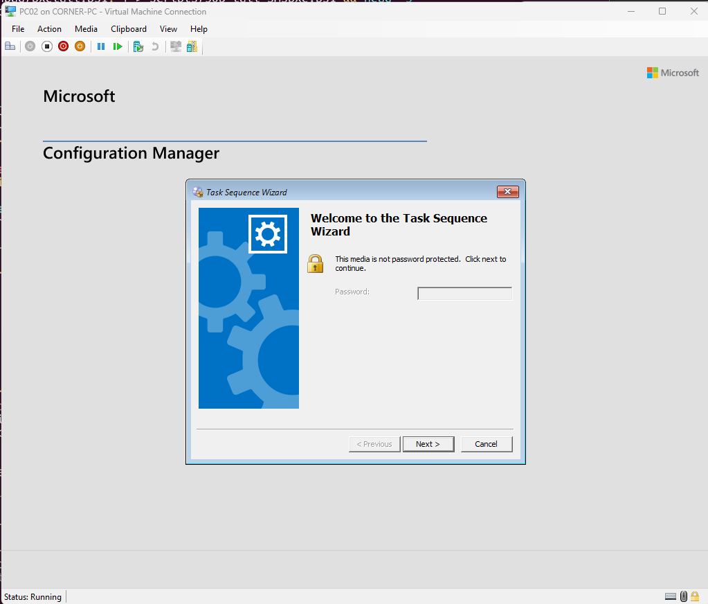
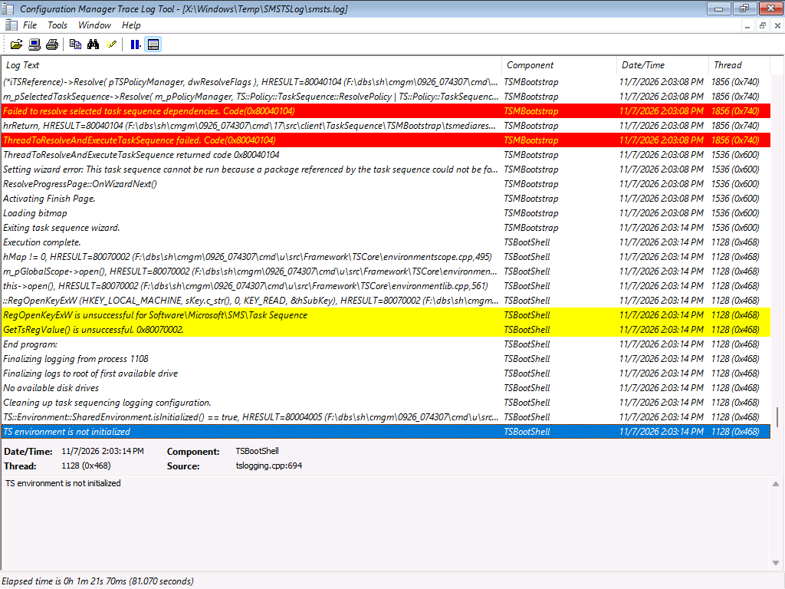
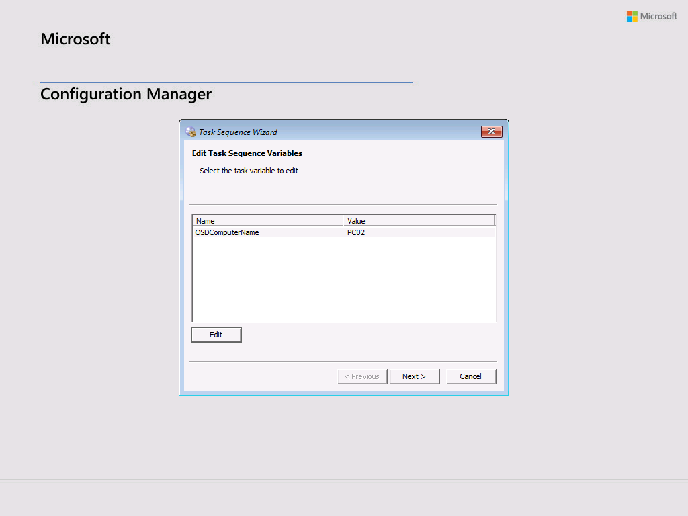
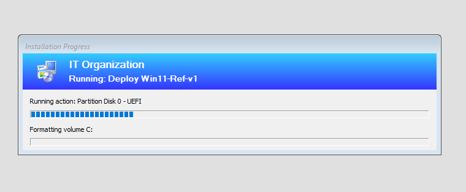
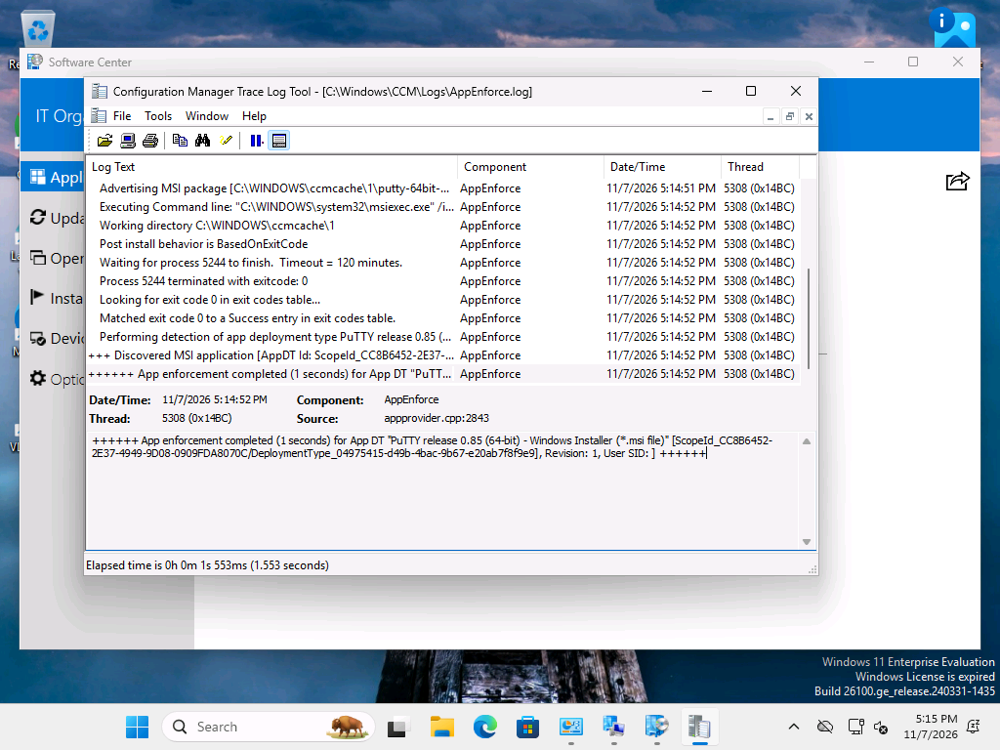

# Microsoft home lab on Hyper-V

A Windows IT lab on one Hyper-V host, built step by step from numbered PowerShell scripts. It covers:

- **Active Directory:** a domain controller with DNS and DHCP, OUs, users from a CSV, everyday helpdesk tasks and a GPO.
- **Microsoft 365 and Entra ID:** Cloud Sync, licences assigned by group, a shared mailbox, a dynamic group and Teams.
- **A Windows 11 golden image:** built in Audit Mode, sysprepped, captured with DISM and deployed by hand.
- **Configuration Manager (SCCM):** imaging PCs over PXE with a task sequence, then deploying and upgrading apps.

Clone it, change the few lab-specific values listed below, and run the scripts in order to build the same lab. Every script has a header saying where it runs, why it exists, and what the same step looks like in the GUI.

## What you end up with

| VM | Role | IP | Notes |
|---|---|---|---|
| DC01 | Windows Server 2025 domain controller, DNS, DHCP | 192.168.100.10 | Forest `lab.dupnet.internal`, NetBIOS `LAB` |
| REF01 | Windows 11 Enterprise reference PC (golden image) | DHCP | Kept generalized and off after the capture |
| PC01 | Deployed by hand from `ref.wim` (WinPE, diskpart, DISM, bcdboot) | DHCP | Domain-joined, gets the Staff GPO |
| CM01 | Configuration Manager 2509 primary site + SQL Server 2022 | 192.168.100.11 | Management point, distribution point and PXE responder |
| PC02 | Imaged over PXE by a ConfigMgr task sequence | DHCP | Name entered in the task sequence wizard |

**Network:** an internal Hyper-V switch `LabNAT` with host NAT on `192.168.100.0/24` (gateway `.1` on the host), and DHCP from DC01 (`.100`-`.199`). An internal switch keeps DC01's DHCP off your home network.

## Requirements

- A Windows 11 Pro/Enterprise host with Hyper-V. This lab ran on a 64 GB host; CM01 alone takes 4-12 GB (dynamic), DC01 about 4 GB, and each client 2-4 GB. The finished lab uses about 220 GB on the big-file drive (ISOs, VHDXs, ADK and SQL media).
- Evaluation media (all free): Windows Server 2025, Windows 11 Enterprise, SQL Server 2022, Configuration Manager 2509 (current branch baseline), the Windows ADK + WinPE add-on.
- A Microsoft 365 trial tenant for scripts 17-24 (Business Premium trial).
- The evaluation clocks run out: Windows Server, SQL Server and ConfigMgr after 180 days, Windows 11 Enterprise after 90 days.

## Change these before you start

| Value | Where | Default |
|---|---|---|
| Big-file folder (ISOs, VHDXs, layouts) | scripts using `D:\home-lab` | `D:\home-lab\` (`iso`, `vms`, `apps`, ...) |
| Domain name | 15 scripts (search for `dupnet` and `LAB\`) | `lab.dupnet.internal` / `LAB` |
| Lab subnet and IPs | 23 scripts (search for `192.168.100.`) | `192.168.100.0/24`, DC01 `.10`, CM01 `.11` |
| M365 tenant | 17 (`-TenantDomain`), 18a, 22, 23 | `contoso.onmicrosoft.com` placeholders |
| Sales Team group's Object ID | 24 (`-GroupId`) | none, required |

Passwords never live in the scripts. They are typed into Windows credential prompts or generated, then saved DPAPI-encrypted under `%USERPROFILE%\.homelab\` (only your Windows account can read them back).

## How the scripts run

- **Numbered in run order.** Letters (`26a`, `50c`) are side steps or fixes that came up along the way.
- **Where each one runs is in its header:** on the host (often elevated), inside a VM, or from the host over PowerShell remoting (CM01, DC01). Host scripts run straight from the clone: `powershell -ExecutionPolicy Bypass -File <path to this repo>\scripts\NN-name.ps1`.
- **Some scripts are records of console clicks** (the app deployments, 50d-50g, 53-55). They say `UNTESTED as a script` in the header: the clicks were the tested path, and the PowerShell is there to show the same steps.

| Scripts | Phase |
|---|---|
| 01-08a | Hyper-V, DC01, NAT network, static IP, AD DS, promotion, health checks |
| 09-16 | OUs, users from CSV, password reset, offboarding, lockout policy and unlock, a Staff GPO |
| 17-24 | Microsoft 365 users, Entra Cloud Sync, group licensing, sign-in blocking from AD, shared mailbox, dynamic group, Teams |
| 25 | DHCP on DC01 |
| 26-35 | REF01 golden image: ADK, apps as silent MSIs, pre-Sysprep checks, Sysprep, DISM capture, checkpoint cleanup |
| 36-42 | PC01 deployed by hand from `ref.wim`, first boot, domain join, GPO check |
| 43-48a | CM01 built with DISM (no Windows Setup), domain join, prerequisites, offline ADK, SQL 2022, schema extension, ConfigMgr 2509 install, least-privilege OSD service accounts |
| 49-50g | OS deployment: boundary group, PXE without WDS, task sequence, PC02 over PXE, troubleshooting, a name prompt for unknown computers |
| 51-55 | VM notes, staging MSIs, an app deployed to an OU-based collection, an upgrade with supersedence |

## Screenshots

**Sysprep blocked by Windows 11's automatic BitLocker encryption** (script 29 checks for it before Sysprep does):

**The task sequence wizard in WinPE after the PXE boot:**

**Troubleshooting a silent reboot: smsts.log in CMTrace with F8 command support on.** 0x80040104 meant the deployment had no policy for the ConfigMgr client package; Update Distribution Points on that package fixed it (script 50e).

**Naming unknown computers:** a blank `OSDComputerName` collection variable makes the wizard ask for the name (script 50g).

**An app installed from Software Center, confirmed in AppEnforce.log** (exit code 0, then MSI detection):

## Gotchas this lab hit

- **Gen 2 VMs: Windows Boot Manager moves itself to the top of the firmware boot order** after Windows installs. A sysprepped VM then boots into OOBE instead of the DVD, and a rebuilt PC skips PXE. Scripts 32 and 50 set the boot order explicitly.
- **Windows 11 encrypts the disk automatically on a VM with a vTPM**, and Sysprep won't generalize an encrypted drive: `manage-bde -off C:` first.
- **A cmd window in Select mode pauses the program inside it.** A DISM capture "stuck at 4%" was just that: press Esc.
- **PowerShell remoting can't use DPAPI or a second hop**, so SQL setup, the schema extension and ConfigMgr setup run as scheduled tasks on CM01 instead.
- **`bcdboot` from the Server 2025 image failed silently on a Windows 11 host;** the host's own `bcdboot` worked. Check results, not just exit codes.
- **A PC that has been through ConfigMgr once is a known computer.** A deployment to All Unknown Computers skips it until its device record is deleted.
- **A fresh Windows 11 eval can say "Windows License is expired" until it activates:** `slmgr /ato`.
- **If WSL uses mirrored networking on the host,** VMs behind the host's NAT can't reach internet ports that something in WSL listens on (port 80 here). HTTPS downloads still worked.

## How this was made

I did the lab by hand: the domain, the golden image, the manual deployment, the PXE builds and the console work in ConfigMgr. The scripts were written with Claude Code as the work went along, so every hand step has a script beside it. The ConfigMgr server build (43-49) was scripted and run by Claude Code from the start.

## License

MIT
